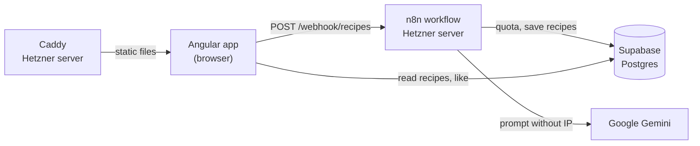
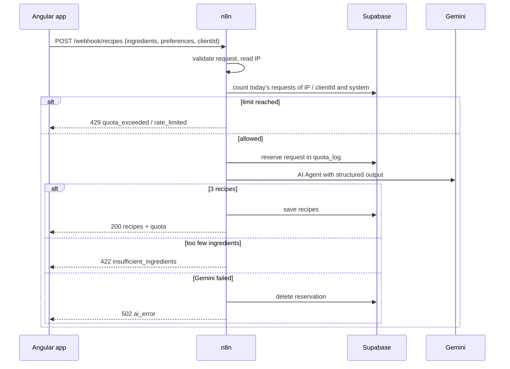

# Architecture

Code à Cuisine has no backend of its own. The Angular app talks to two services: an n8n workflow for everything that costs money or needs secrets, and Supabase for reading the public cookbook.



| Part | Responsibility | Details |
|---|---|---|
| Angular app | input, validation, display, likes in `localStorage` | this repo, `src/` |
| n8n | validation, quota and throttling, Gemini call, saving recipes | [n8n/README.md](../n8n/README.md) |
| Supabase | tables `recipes` and `quota_log`, function `like_recipe` | [database.md](database.md) |
| Caddy | HTTPS, SPA fallback, rate limit for the webhook | [deployment.md](deployment.md) |

The JSON between the parts is defined in [api-contract.md](api-contract.md).

## Generating recipes



The quota is checked and the request is reserved before Gemini is called, so parallel requests cannot exceed the limits. A request counts for a user if its IP or its browser id matches, see [api-contract.md](api-contract.md#quota-and-throttling).

## Reading the cookbook

The cookbook pages read Supabase directly with `supabase-js` and the public publishable key. Row level security only allows `select` on `recipes` and the function `like_recipe`, `quota_log` is not readable from the browser. Lists load only the fields a card shows (`RecipePreview`), the detail page loads the full recipe.

## Frontend

```
src/app/
├── pages/      one folder per route, loaded lazily
├── shared/     reusable components (button, logo, popup, pagination, ...)
├── services/   stores and API access
├── guards/     keep the generator steps in order
├── models/     types, options and validators
└── data/       ingredient suggestions, cuisine banners
```

State lives in signal based services (`@Service()`), components only read and call them:

| Service | Holds |
|---|---|
| `GeneratorStore` | ingredients and preferences across the two generator steps |
| `RecipeStore` | generated recipes, quota and the state of the current generation |
| `RecipeService` | the call to the n8n webhook |
| `CookbookService` | Supabase reads and likes |
| `LikeStore` | liked recipe ids (`localStorage`) and the like counts Supabase returned |
| `PopupStore` | the message of the shared error popup |
| `BackNavigation` | back links that step through the history, with a fallback for direct visits |

The guards send users back to the right step when they open `/generator/preferences`, `/generator/loading` or `/results` without the data those pages need.

Errors from n8n arrive as `{ error: { code, message } }` and are shown in the popup. The app writes nothing to the console.

## Decisions

- **n8n instead of calling Gemini from the browser:** the API key stays on the server, and the quota cannot be bypassed from the browser.
- **AI Agent with a Structured Output Parser:** Gemini returns JSON that matches a schema, a Code node then fixes the details the model may get wrong (cook numbers, parallel steps, order).
- **Supabase instead of Firebase:** paginated lists with `range` and `count`, and plain SQL for the quota queries in n8n.
- **Browser id next to the IP:** devices with IPv4 and IPv6 reach n8n under two addresses. The browser id links both to one user.
- **Recipes are always generated new:** no reuse of stored recipes, so every request gets 3 recipes for exactly these ingredients.
- **Own server instead of GitHub Pages:** Caddy answers deep links with `index.html` and status 200, GitHub Pages would need a copy as `404.html`.
- **Costs:** Gemini runs on the paid tier (about 1 cent per request). The system wide limit of 12 requests per day and a spending limit in Google AI Studio cap the costs.
