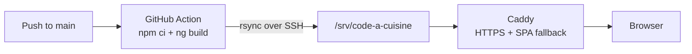

# Deployment

The frontend runs at `https://cuisine.angelodevelopment.de` on the same Hetzner server as n8n. Every push to `main` builds the app with a GitHub Action and copies it to the server.



## DNS

| Type | Name | Value |
|---|---|---|
| A | `cuisine` | IPv4 of the server |
| AAAA | `cuisine` | IPv6 of the server |

## Server

A user without a password and without `sudo` receives the build. It can only write to its own directory.

```bash
adduser --disabled-password --gecos "" deploy
mkdir -p /srv/code-a-cuisine
chown deploy:deploy /srv/code-a-cuisine
```

The public key of the deploy key pair goes to `/home/deploy/.ssh/authorized_keys` (`.ssh` with mode `700`, the file with `600`, both owned by `deploy`).

## Caddy

Caddy runs in Docker with `network_mode: host` (see [n8n/README.md](../n8n/README.md#server)). The build directory is mounted read only:

```yaml
volumes:
  - ./Caddyfile:/etc/caddy/Caddyfile:ro
  - /srv/code-a-cuisine:/srv/code-a-cuisine:ro
```

Site block in the `Caddyfile`:

```
cuisine.angelodevelopment.de {
        root * /srv/code-a-cuisine
        encode zstd gzip
        try_files {path} /index.html
        file_server

        @hashed path_regexp -[A-Za-z0-9_-]{8}\.(js|css)$
        header @hashed Cache-Control "public, max-age=31536000, immutable"
        @unhashed not path_regexp -[A-Za-z0-9_-]{8}\.(js|css)$
        header @unhashed Cache-Control "no-cache"
}
```

- `try_files` answers every unknown path with `index.html` and status 200, so the Angular router handles deep links like `/cookbook/italian`.
- JavaScript and CSS files have a hash in their name and are cached for a year. Everything else, especially `index.html`, is revalidated on every visit, so a new deploy is visible right away.
- Caddy writes no access logs.

Apply changes with `docker compose up -d` in the Caddy directory.

## GitHub Action

[.github/workflows/deploy.yml](../.github/workflows/deploy.yml) runs on every push to `main` that changes more than Markdown files, `docs/` or `n8n/`, and can be started by hand under **Actions**. It builds the app and runs `rsync --delete --delay-updates`, so old files are removed and the new build replaces the old one at once.

Repository secrets (**Settings → Secrets and variables → Actions**):

| Secret | Value |
|---|---|
| `DEPLOY_KEY` | private key of the deploy key pair (ed25519, no passphrase) |
| `DEPLOY_KNOWN_HOSTS` | output of `ssh-keyscan <server-ip>`, run on the server |
| `DEPLOY_USER` | `deploy` |
| `DEPLOY_HOST` | IPv4 of the server |

## n8n

The webhook only accepts requests from known origins. **Allowed Origins (CORS)** in the webhook node lists them without spaces:

```
http://localhost:4200,https://cuisine.angelodevelopment.de
```

Changes to a workflow only take effect after **Publish**.
