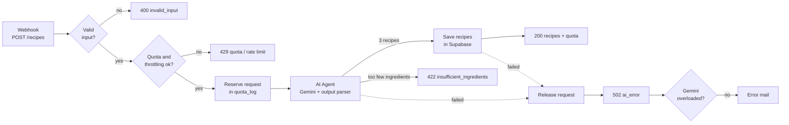

# n8n: Recipe generator

Generates three recipes from the user's ingredients with an AI Agent on Google Gemini and stores them in Supabase. The request and response format is described in [docs/api-contract.md](../docs/api-contract.md), the tables in [docs/database.md](../docs/database.md).

| Workflow | Trigger | What it does |
|---|---|---|
| `generate-recipes.json` | `POST /webhook/recipes` | validates the request, checks quota and throttling, asks Gemini for 3 recipes, saves them and answers the frontend |
| `error-alert.json` | Error Trigger | emails the failed node and error message when the recipe workflow fails |

The recipe workflow must be active (published). The error workflow is set as its error workflow under **Settings → Error Workflow**.

## Recipe workflow



| Node | Purpose |
|---|---|
| Validate request | Checks every field against the rules of the api contract and reads the client IP from `x-forwarded-for` (IPv4 or IPv6). An invalid `clientId` becomes `null` instead of an error. The frontend validates too, this catches direct calls to the webhook. |
| Count requests, Check limits | One query counts today's requests of the user (same IP or same `clientId`) and of the whole system and finds the user's last request. Limits: 3 per user and 12 system wide per day (UTC), 1 request per 10 seconds per user. |
| Reserve request | Inserts the request with IP and `clientId` into `quota_log` before Gemini is called, so parallel requests already see it. |
| Build prompt | Builds the system message and the prompt from the request. User input is wrapped in `<request>` and treated as data only. |
| AI Agent | Google Gemini Chat Model (`gemini-3.6-flash`, temperature 0.6) with a Structured Output Parser. Gemini either returns 3 recipes or `insufficient: true` with a reason. If Gemini fails, for example when it is overloaded, the agent tries once more after 5 seconds. |
| Build result | Adds cuisine, diet, portions, cooks and cooking time from the request, keeps `cook` within the number of cooks, fixes `parallel` and the step order. |
| Save recipes | Inserts the 3 recipes in one query and returns their ids. |
| Release request | Deletes the reservation again if Gemini or saving failed, so the request does not count. |
| Temporary AI error? | Checks the agent's error for `503`, "overloaded", "high demand" or "unavailable". These short Gemini outages end the execution without an alert. |
| Stop and Error | Marks the execution as failed after the user got the `502`, which starts the error workflow. Only reached for errors that are not temporary. |

Requests rejected by Gemini as too few ingredients count against the quota, failures of Gemini or the database do not.

## Credentials

Credentials are only entered in the n8n UI and never stored in this repo. The exports only contain their names.

| Credential | Type | Used by |
|---|---|---|
| Code à Cuisine - Supabase | Postgres | Count requests, Reserve request, Save recipes, Release request |
| Code à Cuisine - Gemini | Google Gemini (PaLM) API | Google Gemini Chat Model, allowed domain `generativelanguage.googleapis.com` |
| SMTP account | SMTP | Error alert |

Supabase setup:

- Use the **Session pooler** connection (Supabase → Connect → Session pooler). The direct connection is IPv6 only, and Docker containers have no IPv6 by default.
- SSL is `Require`. Supabase signs its certificates with its own CA, so n8n needs that CA: download it in Supabase under **Project Settings → Database → SSL Configuration**, put it into `certs/` next to the compose file and add to the n8n service:
  ```yaml
  environment:
    - NODE_EXTRA_CA_CERTS=/certs/prod-ca-2021.crt
  volumes:
    - ./certs:/certs:ro
  ```

## Import and export

Download a workflow in the n8n UI (**⋯ → Download**) and save it as `workflows/<workflow-name>.json`. UI downloads contain no owner data, so they need no cleaning.

To import, use **⋯ → Import from File** in a new workflow, then:

1. select the credentials in every node that uses one,
2. replace the placeholder addresses in the email node of the error workflow (`sender@example.com`, `alerts@example.com`),
3. set the error workflow in the settings of the recipe workflow,
4. add the frontend origin to **Allowed Origins (CORS)** in the webhook node.

## Server

In production n8n runs on a Hetzner Cloud server (Ubuntu, Docker) at `https://n8n.angelodevelopment.de`, shared with another project:

- **Caddy** handles HTTPS and limits `/webhook/*` to 20 requests per minute per IP. It runs with `network_mode: host`, so it sees the real client IPs for both IPv4 and IPv6, and forwards to `localhost:5678`. In a Docker network, IPv6 clients would show up as the gateway address (`172.18.0.1`), and all of them would share one quota.
- **n8n** publishes its port only on the server itself (`127.0.0.1:5678:5678`) and runs with `N8N_PROXY_HOPS=1`, so it trusts the `x-forwarded-for` header from Caddy.
